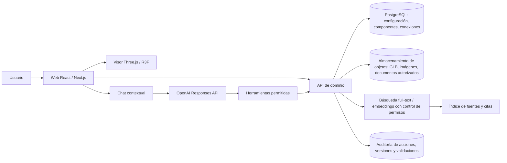

# Plataforma web de gemelo digital interactivo del Cessna 172S Skyhawk

**Investigación y propuesta de implementación**  
**Consulta de fuentes: 3 de noviembre de 2026**  
**Alcance:** herramienta educativa de visualización técnica, no aprobada para mantenimiento, aeronavegabilidad ni reparación.

## 1. Resumen ejecutivo

Es viable construir una plataforma web que permita recorrer, seleccionar, aislar, ocultar, explotar y volver a ensamblar de forma didáctica los sistemas del Cessna 172S; además puede consultar documentación y ejecutar comandos de lenguaje natural. La propuesta inicial es una **maqueta digital estructurada**, con algunos comportamientos educativos deterministas y trazabilidad documental. Sin CAD oficial, acceso a la configuración de un ejemplar y modelos validados, no debe llamarse gemelo físico de alta fidelidad ni simularse como aeronave certificada.

La investigación localizó el proceso FAC **4700019976**, asociado al contrato **149/22-4700019976** en estados financieros oficiales, y una referencia FAC anterior a **CTO 119/22** con Textron Aviation para adquirir Cessna 172S. La FAC también informa entregas por lotes. La evidencia pública consultada confirma familia/modelo y comprador/proveedor, pero no permitió obtener el contrato íntegro, ficha técnica o anexos de configuración. Por ello, no atribuyo al pliego detalles que no pude verificar. Fuentes de prensa basadas en reportes FAC identifican la flota reciente con Garmin G1000 NXi; el registro de importación para FAC2480/2481 identifica Cessna 172S, seriales 172S13244/13246 y motores IO-360-L2A. Esto hace de la flota FAC una referencia prometedora, pero **no prueba que cada aeronave, lote o serial tenga equipo idéntico**. Véase [el apartado de configuración](#31-configuración-de-referencia-y-hallazgo-del-contrato-fac).

**Recomendación:** frontend React/Next.js con React Three Fiber y Three.js; contenido 3D en glTF/GLB; Blender para modelado visual y FreeCAD/Open CASCADE para conversión/inspección CAD cuando existan archivos autorizados; backend TypeScript con PostgreSQL, almacenamiento de objetos, búsqueda documental y un catálogo de herramientas con esquemas estrictos. Mantener el grafo técnico y el estado de vista separados. Integrar el chat en la web mediante API de OpenAI; ofrecer además, si el entorno y plan lo permiten, un MCP App para abrir una experiencia compacta dentro de ChatGPT. El visor web independiente será la aplicación principal para manipulación 3D completa.

## 2. Conclusión sobre viabilidad técnica

| Capacidad | Viabilidad inicial | Condición principal |
|---|---:|---|
| Vista 3D exterior y cabina | Alta | Crear o licenciar un modelo de aspecto general |
| Selección/aislamiento por sistema | Alta | Nombres e IDs estables por pieza o subconjunto |
| Explosionado reversible | Alta | Matrices originales y vectores explosionados guardados |
| Ensamblaje didáctico | Media-alta | Puntos de anclaje, tolerancias gráficas y secuencia propia |
| Relaciones mecánicas/eléctricas/funcionales | Media | Diagramas y publicaciones compatibles con el ejemplar |
| Simulación educativa | Media | Modelos de comportamiento documentados y validados por dominio |
| Gemelo actualizado con telemetría | No disponible sin integración | Sensores/datos de una aeronave, permisos, interfaz y sincronización |
| Mantenimiento aprobado/certificado | Fuera del MVP | Aprobación regulatoria, datos controlados y sistema de calidad aplicable |

La primera entrega es una **maqueta digital**: representación 3D + estructura de activos + fuentes trazables + interacción. El salto a un gemelo conectado exige un activo físico identificado (matrícula/serie), datos de estado autorizados, reglas de calidad y actualización, y métodos de validación. NIST describe el gemelo como una representación que puede modelar estado y transiciones; su trabajo también señala que sensores, conectividad y modelos son elementos importantes para sincronización y predicción ([NIST, definiciones](https://www.nist.gov/digital-twins/definitions-and-state-art), [NIST IR 8356](https://csrc.nist.gov/pubs/ir/8356/final)).

## 3. Definición del gemelo digital propuesto

Se recomienda presentar el producto por niveles, con un rótulo visible de fidelidad:

1. **Modelo 3D:** forma visual sin estructura ni comportamiento.
2. **Maqueta digital:** 3D con árbol de sistemas, metadatos, documentos y relaciones declaradas.
3. **Modelo funcional educativo:** algunos estados y flujos reproducibles con supuestos y límites explícitos.
4. **Representación conectada a una aeronave:** instancia física individual con datos operativos sincronizados.
5. **Gemelo con predicción y control:** modelos validados, sincronización y análisis predictivo; no forma parte de esta propuesta inicial.

En pantallas y exportaciones se debe indicar siempre: variante, configuración/serie aplicable, versión del modelo, fecha de corte, fuente y grado de validación. “Conexión” debe poder significar una relación espacial, mecánica, eléctrica, fluídica, de señal o funcional; nunca se deduce una de otra por la mera proximidad en pantalla.

### 3.1 Configuración de referencia y hallazgo del contrato FAC

La designación **172S** cubre múltiples años, seriales, revisiones, aviónica y modificaciones. El POH/AFM que acompaña a cada avión y sus suplementos aplican a determinados seriales y equipos; por ejemplo, el manual NAV III de Cessna de 2005 identifica su aplicabilidad a seriales **172S9810 en adelante** y registra una revisión concreta, mientras otro POH NAV III/GFC 700 aplica a intervalos de serial diferentes. Estos documentos se encontraron en repositorios de terceros, no en un repositorio público oficial de Textron, por lo que sirven para mostrar la necesidad de controlar alcance y revisión, no para fijar datos de mantenimiento ([ejemplo NAV III 2005, copia alojada por tercero](https://funflightsusa.com/wp-content/uploads/2018/06/POH_172S-G1000.pdf)). La FAA publica el TCDS 3A12 en su sistema de registros ([FAA, TCDS](https://drs.faa.gov/browse/excelExternalWindow/DRSDOCID119659606420240813185757.0001%3FmodalOpened%3Dtrue)); ese certificado no reemplaza la lista de equipos ni la configuración individual.

**Hallazgo sobre contratación:**

- El informe financiero trimestral FAC registra a **Textron Aviation Inc.**, el objeto de adquisición Cessna 172S y el identificador **149/22-4700019976** ([FAC, notas financieras a 30 de junio de 2025](https://www.fac.mil.co/sites/default/files/linktransparencia/PRESUPUESTO/estadosfinancieros/2025/segundotrimestre/notas_a_los_informes_financieros_y_contables.pdf)).
- Un informe financiero FAC de 2023 menciona **CTO 119/22 con Textron Aviation Inc.** para adquisición de Cessna 172S ([FAC, variaciones trimestrales, junio 2023](https://www.fac.mil.co/sites/default/files/linktransparencia/PRESUPUESTO/estadosfinancieros/2023/junio2023/va_trimes_30junio_2023.pdf)). La numeración reportada difiere de la del documento financiero de 2025; podrían corresponder a referencias administrativas del proceso/contrato o a distintos actos, pero las fuentes disponibles no permiten resolver la diferencia.
- La prensa especializada informa entregas de los FAC 2470–2473 en 2021, otros lotes después, y describe la flota reciente con **Garmin G1000 NXi** ([Infodefensa, inventario y adquisiciones](https://www.infodefensa.com/texto-diario/mostrar/5720628/005-colombia-colombia-completa-inventario-16-entrenadores-cessna-172), [Infodefensa, entrega de 2026](https://www.infodefensa.com/texto-diario/mostrar/5915067/096-colombia-tres-nuevos-cessna-172-skyhawk-colombiano-iniciaron-operaciones-entrenamiento)). No es evidencia primaria del anexo técnico contractual.
- Una fuente de comercio exterior muestra a FAC2480 como Cessna 172S serial **172S13244**, motor **L-40337-51E**; y FAC2481 como serial **172S13246**, motor **L-40339-51E**, modelo IO-360-L2A ([registro de importaciones agregado](https://www.volza.com/p/imported-aircraft/buyers/coo-united-states/)). Es una fuente secundaria, útil como pista a confirmar con registros oficiales/placas y documentos de entrega.
- Lycoming lista el **IO-360-L2A** para C-172R y 172S y da datos de catálogo ([Lycoming, Engine Finder](https://www.lycoming.com/engines/10017)). El TCDS 3A12 debe gobernar límites de tipo y configuraciones aprobadas.

**Base propuesta del MVP:** crear `C172S_NAVIII_G1000NXi_FAC_candidate_v1` como **configuración de investigación**, no como afirmación de que represente un serial FAC completo. A partir de las pistas: 172S, motor IO-360-L2A, hélice conforme al TCDS aplicable, dos pantallas Garmin G1000 NXi según instalación aprobada; dejar autopiloto, standby instrument, paquete de luces, interior, sondas, radio y opciones como “pendiente de confirmación” hasta revisar contrato/anexo, equipo instalado y manual aplicable al serial. Si el objetivo posterior es modelar aviones FAC en servicio, usar como caso de control una aeronave individual identificada, por ejemplo FAC2480, solo tras validar matrícula/serial/engine serial y documentación de configuración. No mezclar su configuración con 172R, 172N/P, 172S de dial analógico, ni con 172S tempranos NAV III.

**Sistema de vacío:** no debe eliminarse del árbol por el mero hecho de que el avión lleve G1000. La instalación de reserva y su instrumentación varían con año/serial/equipamiento; los G1000 tempranos pueden coexistir con instrumento de reserva accionado por vacío, y configuraciones posteriores pueden montar GI 275. Modelar variante y evidencia por serie.

## 4. Inventario jerárquico de sistemas

Es una **taxonomía de partida**, no una lista de pieza certificada. Confirmar cada rama con POH/AFM y suplementos aplicables, IPC, AMM, diagrama eléctrico, equipo instalado y serial. ATA puede aportar agrupación y referencias de capítulo donde la fuente lo permita; no se deben copiar nomenclaturas o contenido restringido sin revisar términos/licencias. La documentación de mantenimiento del fabricante se sirve mediante Textron 1View; el acceso a publicaciones de propietario/operación puede requerir iniciar sesión y las publicaciones se administran según cuenta/suscripción ([Textron, acceso a manuals/1View](https://mccauley.txtav.com/en/manuals), [Textron, descripción de 1View](https://media.txtav.com/194414-new-1view-platform-transforms-technical-publications-for-textron-aviation-customers/)).

| Capítulo/área ATA orientativa | Sistema / subsistemas a representar | Nota de configuración |
|---|---|---|
| 05/06 | Inspecciones, dimensiones y zonas | El modelo necesita zonas y estaciones; valores solo de documentación aplicable |
| 21 | Ventilación, calefacción y descongelación | Representar conductos/mandos tras confirmar edición |
| 23 | Comunicaciones y audio | Radios, intercom, audio panel dependen de aviónica instalada |
| 24 | Eléctrico | Batería, alternador, buses, protecciones, interruptores, cargas; diagrama exacto requerido |
| 25 | Cabina/interior/equipamiento | Asientos, mandos, paneles, cinturones y accesorios, configuración por avión |
| 27 | Controles de vuelo | Alerones, elevador, timón, flaps, trim y mecanismos; visual separado de control funcional |
| 28 | Combustible | Depósitos, venteos, drenajes, selector, bomba auxiliar, filtro, líneas/inyección |
| 30 | Protección contra hielo/lluvia | Calefacción pitot; alcance adicional depende de configuración |
| 31/34 | Instrumentos, navegación y vigilancia | G1000/NXi, ADC, AHRS, magnetómetro, GPS, transponder y opcionales |
| 32 | Tren de aterrizaje y frenos | Tren fijo triciclo, ruedas, frenos y amortiguación; no inferir números de parte |
| 33 | Iluminación | Posición, aterrizaje/taxi, estrobos, beacon, luces interiores; opciones por lote |
| 34 | Pitot-estático, navegación | Pitot, static ports, alterno, instrumentos analógicos/reserva y sensores |
| 36/37 | Neumático/vacío | Solo incorporar componentes documentados en la configuración seleccionada |
| 52 | Puertas | Puertas/ventanas y cierres, con geometría representacional |
| 55/56 | Empenaje/ventanas | Superficies, uniones, transparencia; nivel de detalle ligado a disponibilidad CAD |
| 57 | Alas | Estructura, depósitos, controles, luces, puntos de acceso |
| 61 | Hélice | Modelo McCauley según TCDS/serial; no completar sin confirmación |
| 71/72/73/74/79/80 | Planta motriz | IO-360-L2A, admisión, combustible/inyección, escape, aceite, encendido y arranque; unidad concreta depende de serie |
| 77/79 | Indicaciones y aceite | Sensores y pantallas, trazando interfaz eléctrica y física por separado |

Jerarquía sugerida: `Aircraft → Configuration → System → Subsystem → Assembly → Component → Part`. Para el ala, por ejemplo, modelar el conjunto del ala izquierda, tanque izquierdo, superficies de control, bisagras y actuadores solo en el nivel respaldado por fuentes. Distinguir **pieza física**, **instancia instalada** y **número de parte**: un mismo número de parte puede aparecer varias veces y una parte sustituta puede depender de fecha/serie.

Cada objeto debe almacenar: `id` inmutable, nombre normalizado, alias, clasificación, padre, aplicabilidad por serial/fecha, número de parte con referencia documental, ubicación local y global, activo geométrico y revisión, transformaciones, material solo si se conoce, función en paráfrasis propia, dependencias, conexiones tipadas, fuentes con páginas/revisión, validación, incertidumbre y nivel de detalle.

## 5. Fuentes documentales y activos 3D

| Fuente | Aporta | Acceso y límite |
|---|---|---|
| Textron 1View: POH/AFM, IPC, AMM, diagramas | Fuente principal para una aeronave/serie y revisión aplicables | Portal del fabricante; acceso y reutilización deben revisarse. Una suscripción de consulta no equivale a permiso para volver a publicar PDFs o dibujos |
| FAA TCDS 3A12 y AD | Tipo certificado, combinaciones y directivas | Acceso oficial abierto; no define por sí solo el equipo instalado de cada unidad |
| Garmin, guías Nav III | Arquitectura/uso general G1000 para familias Cessna Nav III | Las guías de piloto no sustituyen datos de instalación o mantenimiento. Garmin advierte que aeronaves con integrated flight decks deben solicitar manuales al fabricante ([Garmin](https://www.garmin.com/en-GB/aviation/training/)) |
| Lycoming, manuales y boletines | Motor y publicaciones de fabricante | Confirma el modelo IO-360-L2A y su aplicabilidad general; el serial y revisión gobiernan |
| Fotografías FAC/Textron | Forma exterior, librea, cabina y comprobación visual | Útiles para apariencia; licencia de foto y ángulos no garantizan dimensiones internas |
| CAD/3D | Geometría, ensamblaje y ubicaciones | No se halló en esta búsqueda un modelo CAD oficial C172S completo con autorización de redistribución. No dar por libre un modelo comunitario o de simulador |

No copiar manuales protegidos al repositorio de producto. Guardar referencias, páginas, hash del documento cuando esté permitido y extractos mínimos licenciados; para RAG, restringir el índice a usuarios autorizados y conservar permisos, procedencia y periodo de acceso. Modelar datos propios basados en requisitos públicos y generar geometría simplificada original para el MVP.

## 6. Comparativa tecnológica

Versiones citadas en páginas oficiales consultadas a **03-11-2026**; se recomienda fijar versiones estables al iniciar el desarrollo, ya que se actualizan.

| Opción | Uso recomendado | Piezas/ensamblajes, rendimiento y React | Coste/licencia y limitaciones |
|---|---|---|---|
| Three.js | Motor gráfico web flexible | Picking, scene graph, animación, WebGL; GLTFLoader lee glTF 2.0 y extensiones ([docs](https://threejs.org/docs/pages/GLTFLoader)) | MIT; buen encaje en web; requiere construir UX, árbol, restricciones y manejo de estados |
| React Three Fiber | Composición React sobre Three.js | Componentes declarativos y ecosistema React; excelente integración Next.js | MIT; la misma capacidad gráfica de Three.js, no añade un kernel CAD ni ensamblaje paramétrico |
| Babylon.js | Motor 3D más integrado | Picking, animación, colisiones, WebXR, WebGPU/WebGL y loaders de glTF/OBJ/STL ([especificaciones](https://www.babylonjs.com/specifications/)) | Apache-2.0; más herramientas incluidas; curva y arquitectura mayores si la aplicación ya vive en React |
| Autodesk Platform Services Viewer | Inspección web CAD/BIM existente | Traduce 60+ formatos a formato de visualización, expone metadatos/objetos ([APS](https://aps.autodesk.com/developer/documentation/)); destaca para modelos CAD grandes y propiedades | Dependencia cloud/servicio, autenticación, límites/precio y condiciones comerciales que deben cotizarse; menos control sobre look/flujo 3D propio |
| Blender | Autoría visual, limpieza y exportación | DCC generalista: materiales, rigging/animación, glTF; no es backend CAD paramétrico | GPL para la aplicación; el arte creado no hereda GPL ([Blender](https://www.blender.org/about/license/)); gran opción de producción sin coste de licencia |
| FreeCAD | CAD paramétrico, inspección y preparación | Edición de STEP/IGES y ensamblajes vía workbenches; exportación de mallas/glTF depende de flujo/versiones | LGPL-2.1+ según repositorio oficial ([licencia](https://github.com/FreeCAD/FreeCAD-documentation/blob/main/wiki/License.md)); no es visor de producción web |
| Open CASCADE (OCCT) | Kernel CAD y conversión | B-rep, STEP/IGES; puede integrarse en servicios o WASM, con coste de ingeniería | El kernel es LGPL con excepciones en ciertas distribuciones comerciales; auditar licencia concreta y obligaciones antes de distribuir |
| glTF/GLB | Formato de entrega al navegador | Formato abierto, carga rápida, jerarquías/nodos/materiales/animaciones; buen runtime | No preserva toda semántica paramétrica CAD ni todas las tolerancias/relaciones. Mantener manifest técnico aparte |
| STEP AP242/AP214, IGES, STL/OBJ | Intercambio CAD/mesh | STEP conserva geometría CAD/estructura mejor; IGES legado; STL/OBJ malla sin semántica rica | No cargarlos en el visor principal sin conversión/tesselación y auditoría de metadatos/licencia |

**Decisión:** React Three Fiber + Three.js para el visor; glTF/GLB como formato runtime; CAD se conserva en vault seguro como fuente maestra con exportador de preparación. Babylon es alternativa si se priorizan funciones integradas de motor/colisiones/XR. APS es viable si el cliente ya necesita viewing de muchos formatos CAD y acepta su servicio, modelo comercial y dependencia. Para la necesidad descrita, arquitectura híbrida con backend técnico es la mejor a largo plazo, pero el MVP implementa el visor propio primero.

## 7. Arquitectura recomendada



**Frontend:** Next.js/React, R3F/Three.js, Zustand o estado React limitado para cámara/selección, TanStack Query para datos, panel accesible y responsive. Cada nodo de glTF incluye `componentId`; metadata no voluminosa puede ir en extras glTF y la autoridad de estado vive en backend.

**Backend:** API REST/OpenAPI o GraphQL tipada; servicios separados lógicamente para catálogo/configuración, gestión de geometría/documentos, búsqueda y orquestación de IA. PostgreSQL para datos transaccionales y relaciones versionadas; almacenamiento S3-compatible para modelos; búsqueda híbrida con filtros por documentos autorizados. Un motor de reglas valida `setVisibility`, `isolate`, `explode`, `reset`, `focus` y `showSources` contra IDs existentes. El asistente no cambia geometría ni DB directamente.

**Autenticación/seguridad:** login por organización, roles, permiso documental por publicación, registro de acciones. Separar instrucción del sistema de contenido extraído de manuales; tratar documentos como datos no confiables para mitigar prompt injection. No enviar material restringido al proveedor IA sin autorización contractual y controles de retención apropiados.

## 8. Diseño de la experiencia interactiva

| Modo | Interacción | Implementación segura |
|---|---|---|
| Avión completo | Rotar, zoom, desplazar, escoger | Controles orbitales, selección por raycast, panel de datos y búsqueda de componentes |
| Sistemas | Activar sistema, silueta, ocultar/atenuar otros | Filtro por membership multivaluado; conservar jerarquía original y marcar pertenencia visual |
| Explosionado | Slider por nivel y botón reset | Guardar transform original; vector normalizado por subensamble; interpolar a offset; reversibilidad determinista |
| Ensamblaje didáctico | Arrastrar conjunto, alinear, snap, reiniciar | Frames locales, anchors, transform objetivo, tolerancia gráfica, colisión aproximada; completar con secuencia declarada propia |
| Funcionamiento | Animar flujo/energía/señal | Aristas tipadas en un overlay con leyenda; estado “ilustración educativa” y prerequisitos visibles |
| Documentación | ficha técnica, fuentes, páginas | Título/identificador, aplicabilidad, revisión, extracto autorizado, permalink y estado de validación |

El modo de ensamblaje no debe reproducir pares, torque, pasos, tolerancias ni instrucciones de mantenimiento reales sin datos aprobados. El “snap correcto” solo significa que el objeto coincide con el punto didáctico creado para el ejercicio. Usar shape proxies/box colliders en el MVP; colisiones exactas B-rep no son necesarias para aprendizaje visual.

## 9. Integración con ChatGPT

Hay dos experiencias complementarias:

1. **Aplicación propia (principal):** el chat comparte sesión y selección con el visor. Responses API usa herramientas tipadas o llamadas a funciones. Más control sobre escena, responsive, autenticación, telemetría y pruebas.
2. **ChatGPT App/MCP App (opcional):** un servidor MCP remoto ofrece herramientas y un widget/iframe con tarjeta, selector o visor reducido. La documentación de OpenAI describe MCP Apps UI en iframe y modos inline/fullscreen, y la disponibilidad depende de los planes/ajustes del espacio ([quickstart MCP](https://developers.openai.com/plugins/build/app-quickstart), [UI de ChatGPT](https://developers.openai.com/plugins/build/chatgpt-ui), [modo desarrollador y despliegue](https://help.openai.com/en/articles/12584461-developer-mode-and-full-mcp-connectors-in-chatgpt)). Un componente en ChatGPT no equivale a insertar todo el sitio como si fuera un canvas ilimitado: hay CSP, iframe y permisos de host.

Una acción de un GPT personalizado vía OpenAPI es otra opción limitada; se configura con esquema y autenticación, y espacios de trabajo pueden restringir dominios ([OpenAI, GPT Actions](https://help.openai.com/en/articles/9442513-configuring-actions-in-gpts)). Para una app con interfaz 3D en ChatGPT, MCP Apps resulta el patrón más adecuado, cuando esté habilitado.

**Herramientas del asistente** (solo estas operaciones de escena):

```json
{
  "type": "object",
  "properties": {
    "action": {"enum": ["show_system", "isolate_component", "explode", "assemble_step", "explain_relation", "reset_view", "show_sources"]},
    "targetId": {"type": "string"},
    "systemId": {"type": "string"},
    "level": {"enum": ["system", "subsystem", "assembly", "component"]},
    "relationType": {"enum": ["physical", "electrical", "fluid", "signal", "functional"]}
  },
  "required": ["action"]
}
```

La app resuelve alias con búsqueda de catálogo; ante dos “alternator” o ausencia de pieza pregunta/enumera opciones y no ejecuta. API devuelve un evento de escena con IDs canónicos y texto de razón: `sceneCommandId`, `action`, `targets`, `configurationVersion`, `evidenceIds`, `status`. Visor valida IDs, aplica el cambio y devuelve estado estructurado al modelo para explicarlo. Toda respuesta documental RAG cita título, número/revisión, página/figura y aplicabilidad; si una afirmación no tiene fuente, responde “sin evidencia suficiente”.

## 10. Esquema de datos y ejemplos JSON

Modelo relacional mínimo:

| Entidad | Claves y relaciones principales |
|---|---|
| `Aircraft` | `aircraft_id` PK, fabricante/modelo; define familia |
| `AircraftConfiguration` | `configuration_id` PK, aircraft FK, serialFrom/To, fecha, aviónica/engine IDs, revisión y estado |
| `System` / `Subsystem` | PK; `parent_id` para jerarquía, clasificación/origen |
| `Assembly` | PK, parent assembly/system, frame, orden e instancias |
| `Component` | PK, assembly FK, componente lógico y aplicabilidad; una instalación es distinta de la definición de parte |
| `Part` | PK, manufacturer/partNumber/revision, replaces, fuente/aplicabilidad |
| `GeometryAsset` | PK, object URI, format, hash, bytes, LOD, unidad, coordinateSystem, licencia, revisión |
| `Connection` | PK, source/target component FK, tipo, dirección, especificación, sourceRef FK, validación |
| `Document` | PK, title, publisher, docNo, revision, date, rights, storageRef, allowedRoles |
| `SourceReference` | PK, document FK, page/figure/table, quoteHash/span, applicability, claim/evidence relation |
| `SimulationState` | PK, scenario/configuration FK, state schema/version, assumptions, validation status |
| `AssemblyOperation` | PK, scenario, from/to component, anchor transforms, sequence, tolerance class educational, evidence/author |

Versionar configuración y contenido con `valid_from`, `valid_to`, `revision`, `supersedes_id`, `source_snapshot`, estado inmutable publicado. Cada afirmación de función/conexión debe tener referencia y status `verified`, `derived`, `illustrative`, `unverified` o `rejected`. Un cambio de modelo no debe reescribir evidencia histórica.

Ejemplo de componente:

```json
{
  "id": "cmp-fuel-tank-left-001",
  "configurationId": "C172S_NAVIII_G1000NXi_FAC_candidate_v1",
  "type": "component",
  "name": "Depósito de combustible del ala izquierda",
  "systemId": "sys-fuel",
  "parentId": "asm-left-wing",
  "part": {"partNumber": null, "status": "not_documented"},
  "position": {"frame": "aircraft", "translation_m": [-1.2, 0.1, 0.3], "rotation_quaternion": [0, 0, 0, 1]},
  "geometry": {"assetId": "geo-left-wing-tank-v1", "node": "FuelTank_L", "lod": "schematic", "units": "m"},
  "connections": [
    {"id": "conn-tank-selector", "targetId": "cmp-fuel-selector-001", "kind": "fluid", "direction": "outgoing", "status": "schematic_only", "sourceRefId": null}
  ],
  "function": {"text": "Parte del almacenamiento y alimentación de combustible; descripción pendiente de cotejo con la publicación aplicable.", "sourceRefIds": []},
  "validation": {"status": "illustrative", "reviewer": null, "reviewedAt": null, "uncertainty": "Geometría esquemática; aplicabilidad por serie pendiente."},
  "version": 1
}
```

Las coordenadas del ejemplo son marcadores arbitrarios para demostrar el esquema; **no representan ubicación real**. En un sistema en producción, impedir su exportación como geometría verificada.

## 11. Especificación del MVP

### Demostración funcional

- Avión exterior esquemático con jerarquía y nodos de cabina simplificados; GLB de una sola escena.
- Tres sistemas demostrables: estructura (geometría educativa), combustible (tanques/rutas esquemáticas) y eléctrico/aviónica (buses/cajas como proxies), con leyenda que declara el diferente grado de precisión.
- Selección e aislamiento, caja de información y estado de evidencia.
- Vista explosionada predefinida con reset y slider.
- Ejercicio de encaje didáctico de tres componentes con anchors fijos y evaluación gráfica.
- Ficha técnica, cada una ligada a por lo menos una referencia pública o marcada “sin fuente aplicable verificada”.
- Asistente con siete comandos tipados, aclaración por ambigüedad y comandos de solo vista.
- Panel de fuentes con vínculo, fecha, revisión, página y estado de derechos.

### Geometría provisional

No esperar al CAD oficial. Construir una silueta visual aproximada desde cero (alas, fuselaje, empenaje, tren fijo, carenado; sin afirmar dimensiones exactas), y representar los sistemas internos con líneas y volúmenes esquemáticos. Etiquetar `visual_approximate`; todas las proporciones en partes internas como `not_to_scale`. La paleta/livery FAC se agrega solo con autorización de imágenes/logotipos. La importación posterior de CAD se transforma a GLB con `componentId` persistente y validación de orientación, unidades, estructura y peso de archivo.

## 12. Riesgos y mitigaciones

| Riesgo | Mitigación |
|---|---|
| No hay CAD oficial disponible públicamente o redistribuible | Geometría propia simplificada; contrato de datos/licencia antes de integrar activos de terceros |
| Derechos sobre AMM/IPC/diagramas/POH | Mantener en sistema autorizado; pedir permiso de indexación/redistribución; citar sin copiar páginas protegidas |
| Variantes y modificaciones postventa | Versiones de configuración por serial, STC/suplementos y revisión; no asumir uniformidad de flota |
| Información incompleta/discordante | `unknown` explícito, registro de discrepancias y flujo de revisión por SME |
| Malla aproximada que parece exacta | Badge persistente de fidelidad, LOD, escala y validación; prevenir que UI la denomine plano/parte conforme |
| Modelo 3D lento | GLB comprimido Draco/meshopt y texturas KTX2, LOD, cargas por sistema, instancias y targets de GPU |
| Error o prompt injection de IA | RAG con permisos; tools de lista cerrada; confirmar entidad; validar respuesta y acción en backend; logs |
| Simulación confundida con procedimiento | Watermark “educativa, no aprobada”; evitar secuencias de mantenimiento, límites o valores no autorizados |
| Seguridad de datos FAC | No asumir que documentos operacionales pueden salir a nube; clasificación, residencia, cifrado y aprobación de datos |
| ChatGPT no controla directamente el runtime web | Mensajes MCP/API devuelven eventos; visor del propio producto aplica acciones; fallback a abrir la app web |

## 13. Presupuesto y estimaciones

Estimaciones preliminares de planificación en USD, no cotizaciones ni precios publicados. Excluyen impuestos, adquisición de licencias/documentación del fabricante, compra de CAD, aprobación regulatoria y contratación institucional. Rango asume equipo remoto mixto de producto, 3D, web/backend, IA y experto aeronáutico puntual; incertidumbre alta hasta conocer derechos y alcance.

| Fase | Esfuerzo estimado | Duración calendario | Coste de servicios estimado |
|---|---:|---:|---:|
| 1. Investigación y requisitos | 3–5 persona-semanas | 2–3 sem. | $8k–$20k |
| 2. Modelo simplificado + visor | 8–13 persona-semanas | 4–6 sem. | $25k–$60k |
| 3. Sistemas/interacción/ensamble | 7–11 persona-semanas | 4–6 sem. | $22k–$55k |
| 4. IA y RAG controlado | 5–8 persona-semanas | 3–5 sem. | $18k–$45k |
| 5. Simulación educativa | 5–10 persona-semanas | 4–7 sem. | $18k–$50k |
| 6. Revisión, rendimiento y expansión | 4–8 persona-semanas | 3–6 sem. | $15k–$40k |
| **MVP demostrable (fases 1–4, en solape)** | **23–37 persona-semanas** | **12–18 sem.** | **$75k–$180k** |

Costes operativos del MVP: hosting, BD, storage y logs pueden empezar en cientos de USD/mes y subir según concurrencia/archivos; API IA variable por modelo, entradas, salidas y volumen. APS, Textron publications y activos de autoría/stock requieren cotización/condiciones actuales. Presupuestar por separado 10–25% de contingencia para licencias, conversiones, revisión aeronáutica y corrección CAD. Las cifras son estimaciones internas de esfuerzo, no evidencia empírica de proveedores.

## 14. Hoja de ruta por fases

| Fase | Entregables y dependencias | Criterio de aceptación |
|---|---|---|
| 1 — Investigación/especificación | Configuración objetivo; registro de discrepancias; permisos; árbol; schema; requisitos de calidad. Depende de acceso al contrato FAC/anexo o a documentos de un avión | Cada dato crítico tiene fuente, aplicabilidad y estado; no quedan piezas críticas presentadas como verificadas sin evidencia |
| 2 — Modelo 3D inicial | Blender/FreeCAD; glTF; árbol navegable; 3 sistemas como proxies | Carga web, IDs estables, unidades/ejes documentados, anotación de geometría aproximada |
| 3 — Interactividad | Picking, aislamiento, explosión, anchors y ejercicio de ensamblaje | Todas las acciones revierten; solo snap educativo; selección actualizada en panel |
| 4 — IA | API, retrieval autorizado, funciones JSON, citas y auditoría | Conjunto de comandos esperado pasa verificación manual; IA no puede invocar acción fuera del esquema |
| 5 — Simulación | Uno o dos modelos educativos (por ejemplo, flujo conceptual) con estados y supuestos | Modelo probado contra fuentes competentes, límites visibles; sin presentación como certificación |
| 6 — Validación/ampliación | Pruebas de carga, cobertura de fuentes, revisión SME, más sistemas/configuraciones | Presupuesto de rendimiento definido y revisado; versión publicada con changelog, validación y cobertura |

## 15. Recomendación final

Construir primero una **maqueta técnica de C172S con configuración FAC candidata**, no un gemelo conectado. Adoptar el caso conocido como 172S con G1000 NXi e IO-360-L2A como hipótesis de trabajo, no consolidar como verdad de toda la flota hasta verificar el pliego, la ficha técnica, seriales entregados y configuraciones instaladas. Solicitar a FAC/Textron el contrato y anexo técnico del proceso 4700019976 (también referencias 119/22 y 149/22), más la lista de equipos por matrícula/serial y permiso explícito de uso de materiales.

El resultado técnico ideal combina un visor web de propiedad del proyecto con un catálogo relacional y un asistente acotado a búsquedas y eventos de escena. Deja que el diseño progrese incluso antes de obtener CAD oficial, pero hace que cada dato nuevo tenga procedencia, versión y estado de verificación.

### Backlog priorizado

| Prioridad | Trabajo |
|---|---|
| P0 | Recuperar contrato/adendas/anexo técnico FAC y mapear denominación 119/22 vs 149/22/4700019976 |
| P0 | Fijar ejemplar de referencia, serial, año, aviónica, motor, hélice y documentos efectivos |
| P0 | Diseñar taxonomy/schema con relaciones físicas separadas de funcionales |
| P0 | Crear GLB simplificado por IDs estables, con advertencias de escala/fidelidad |
| P1 | Implementar aislamiento, selección, árbol y ficha contextual |
| P1 | Implementar explosionado reversible y anchors para tres ejercicios |
| P1 | Añadir API de fuentes, permisos, versionado y auditoría |
| P1 | Añadir llamadas IA tipadas, búsqueda con citas y control de ambigüedad |
| P2 | Añadir uno o dos flujos educativos validados |
| P2 | Evaluar APS, CAD real, telemetría, colaboración multiusuario y app MCP ChatGPT |

### Primeros diez pasos

1. Pedir a FAC el expediente y anexo técnico completo de **4700019976**, incluidos anexos, aclaraciones y modificaciones; buscar simultáneamente las referencias **119/22** y **149/22**.
2. Confirmar si el objetivo es el ejemplar FAC2480 u otra matrícula y obtener serie de fuselaje/motor y lista efectiva de equipos.
3. Solicitar la POH/AFM con revisión y suplementos aplicables, y acceso/licencia a IPC, AMM y wiring diagram del serial.
4. Crear un registro de afirmaciones con fuente, página, fecha, serie y nivel de certeza.
5. Definir configuration ID y árbol de sistemas para el alcance MVP; marcar vacío/aviónica como variables por configuración.
6. Definir marco de coordenadas, unidades, política de IDs y contrato de metadatos glTF.
7. Bocetar geometría propia de fuselaje/alas/tren y tres sistemas internos, todos marcados como aproximados.
8. Implementar visor con carga GLB, picking, árbol y aislamiento con tres ramas.
9. Añadir explosionado/reset y ejercicio didáctico de encaje mediante anchors fijos.
10. Añadir RAG con permisos y herramientas cerradas; revisar manualmente respuestas/citas y comandos antes de enseñar el prototipo.

## 16. Bibliografía y enlaces verificables

Fuentes consultadas el 3 de noviembre de 2026; las fuentes web dinámicas pueden cambiar.

### Aeronave, contrato y documentación

- [FAA DRS: TCDS 3A12](https://drs.faa.gov/browse/excelExternalWindow/DRSDOCID119659606420240813185757.0001%3FmodalOpened%3Dtrue).
- [FAA: cómo localizar TCDS](https://www.faa.gov/faq/how-can-i-locate-type-certificate-data-sheet-tcds-aircraft).
- [FAC: notas financieras al 30 de junio de 2025](https://www.fac.mil.co/sites/default/files/linktransparencia/PRESUPUESTO/estadosfinancieros/2025/segundotrimestre/notas_a_los_informes_financieros_y_contables.pdf).
- [FAC: informe de variaciones, junio de 2023](https://www.fac.mil.co/sites/default/files/linktransparencia/PRESUPUESTO/estadosfinancieros/2023/junio2023/va_trimes_30junio_2023.pdf).
- [Textron Aviation 1View: acceso a publicaciones](https://mccauley.txtav.com/en/manuals).
- [Textron Aviation: anuncio de plataforma 1View](https://media.txtav.com/194414-new-1view-platform-transforms-technical-publications-for-textron-aviation-customers/).
- [Garmin: manuales aeronáuticos y guías de piloto](https://www.garmin.com/en-GB/aviation/training/).
- [Garmin G1000 Pilot’s Guide para Cessna Nav III](https://static.garmin.com/pumac/190-00498-08_0A_Web.pdf).
- [Lycoming IO-360-L2A Engine Finder](https://www.lycoming.com/engines/10017).
- [Lycoming Service Instruction 1497A](https://www.lycoming.com/content/service-instruction-no-1497a).
- [Textron Fact Book 2021](https://www.textron.com/assets/FB/2021/aviation.html).
- [POH/AFM Nav III 2005 (copia en repositorio de tercero; validar contra Textron)](https://funflightsusa.com/wp-content/uploads/2018/06/POH_172S-G1000.pdf).
- [FAC, informe sobre flota de 16 C172](https://www.infodefensa.com/texto-diario/mostrar/5720628/005-colombia-colombia-completa-inventario-16-entrenadores-cessna-172).
- [FAC: entrega y descripción G1000 NXi 2026, vía Infodefensa](https://www.infodefensa.com/texto-diario/mostrar/5915067/096-colombia-tres-nuevos-cessna-172-skyhawk-colombiano-iniciaron-operaciones-entrenamiento).
- [Volza: registros de importación FAC2480/2481 (fuente secundaria)](https://www.volza.com/p/imported-aircraft/buyers/coo-united-states/).

### Gemelos digitales y software

- [NIST: definiciones y estado del arte de digital twins](https://www.nist.gov/digital-twins/definitions-and-state-art).
- [NIST IR 8356: seguridad y confianza](https://csrc.nist.gov/pubs/ir/8356/final).
- [Three.js GLTFLoader](https://threejs.org/docs/pages/GLTFLoader).
- [Babylon.js specifications](https://www.babylonjs.com/specifications/).
- [Autodesk Platform Services](https://aps.autodesk.com/developer/documentation/).
- [Blender license](https://www.blender.org/about/license/).
- [FreeCAD license](https://github.com/FreeCAD/FreeCAD-documentation/blob/main/wiki/License.md).
- [Open Cascade CAD Assistant y formatos](https://www.opencascade.com/products/cad-assistant/).

### OpenAI y ChatGPT

- [OpenAI: MCP server/UI quickstart](https://developers.openai.com/plugins/build/app-quickstart).
- [OpenAI: agregar UI a un MCP server](https://developers.openai.com/plugins/build/chatgpt-ui).
- [OpenAI Help: Developer mode y MCP Apps](https://help.openai.com/en/articles/12584461-developer-mode-and-full-mcp-connectors-in-chatgpt).
- [OpenAI Help: GPT Actions](https://help.openai.com/en/articles/9442513-configuring-actions-in-gpts).
- [OpenAI API: construir MCP servers](https://developers.openai.com/api/docs/mcp).


## Paquete de evidencia E1–E5 y archivos de integración

Este paquete convierte la investigación disponible en registros importables. Los niveles distinguen evidencia contractual y técnica oficial, referencias de tipo, fuentes secundarias y activos didácticos. Una fuente general del 172S no demuestra qué equipo tiene instalada una matrícula FAC concreta.

- **E1 — compra e inventario institucional:** documentos de la FAC/EMAVI y trazabilidad SECOP. Confirma proveedor, objeto y lotes en el alcance indicado; no localizamos el contrato íntegro ni su anexo de configuración.
- **E2 — publicaciones técnicas:** portal Textron y catálogos de IPC, WDM y manual de mantenimiento, además de referencias del motor. Identifican las publicaciones a consultar, pero no se adjuntan los manuales protegidos ni se establece la aplicabilidad por serial FAC.
- **E3 — tipo y geometría general:** FAA TCDS y dibujo Three View del expediente NTSB. Sirven para dimensiones/tipo y proporciones, no como planos CAD licenciados o geometría exacta de una aeronave entregada.
- **E4 — identificación por matrícula/serial:** registros fotográficos o transcripciones secundarias que publican un serial de célula o motor concreto. Son útiles para investigación, pero deben cotejarse con placa, logbook o acta de aceptación oficial.
- **E5 — contexto y activos de referencia:** prensa especializada, fotografías de terceros y malla abierta FlightGear. Aporta cronología/imagen; el GLB existente corresponde a C172P, no a 172S/FAC.

### Archivos de datos incluidos

- `data/evidence_register.csv`: fuentes, afirmaciones, alcance y límites E1–E5.
- `data/aircraft_registry.csv`: las 19 matrículas FAC2470–FAC2488 y seriales publicados que se pudieron corroborar sin inferir los faltantes.
- `data/geometry_manual_sources.csv`: geometría, licencias, manuales y estado de disponibilidad. No contiene archivos protegidos.
- `data/component_fichas_evidence.csv`: exportación de las fichas de componente que ya existen en el proyecto, con fuentes enlazadas y estado explícito de verificación.
- `scripts/export_component_fichas.py`: exportador reproducible del catálogo embebido en `index.html`.

### Estado de seriales

Las fuentes consultadas publican los seriales de célula **FAC2471 / 172S12613**, **FAC2472 / 172S12615**, **FAC2473 / 172S12620**, **FAC2480 / 172S13244**, **FAC2481 / 172S13246** y **FAC2485 / 172S13429**. La fuente secundaria de importación también atribuye seriales de motor a FAC2480 y FAC2481. Los demás campos se dejan vacíos en el CSV; no se rellenan por secuencia ni por lote.

### Geometría, fotos y manuales

No se encontró una malla 172S de la FAC con una licencia compatible y trazable, ni planos CAD del fabricante con permiso abierto de reutilización, ni un escaneo de una unidad FAC. El activo local conserva utilidad didáctica y su licencia GPL-2.0, pero es C172P. El dibujo Three View de NTSB se registra como enlace de referencia y sin licencia abierta identificada; no se copia al repositorio. El candidato comercial de Cubebrush no se adquirió ni se redistribuye. Las fotos enlazadas permanecen alojadas por sus autores.

El IPC 172RPC, WDM 172RWD y 172RMM se anotan como faltantes autorizados por Textron/Veryon. No se incluyen copias encontradas en repositorios de terceros. Para cerrar configuración faltan el expediente/anexo de compra, lista de configuración Textron, actas por aeronave, seriales oficiales y documentos vigentes aplicables a cada unidad.

### Alcance de las fichas exportadas

El CSV refleja el inventario didáctico existente. Las referencias IPC asociadas a despieces identifican la figura o página como fue cargada en Atlas, pero **no certifican que la pieza esté instalada en una matrícula FAC**. Las fichas NXi son una arquitectura de referencia; opciones como GFC 700, variantes de transpondedor, versión de software y reserva deben verificarse con la lista de equipo por serial. Las geometrías incluidas o trazadas siguen marcadas como C172P o didácticas.
